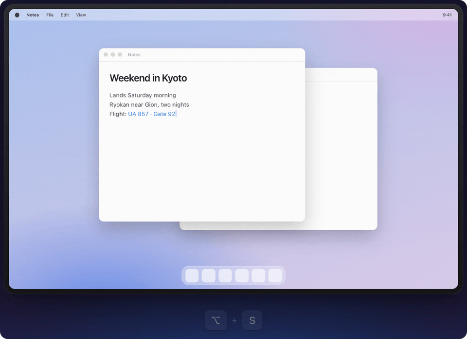
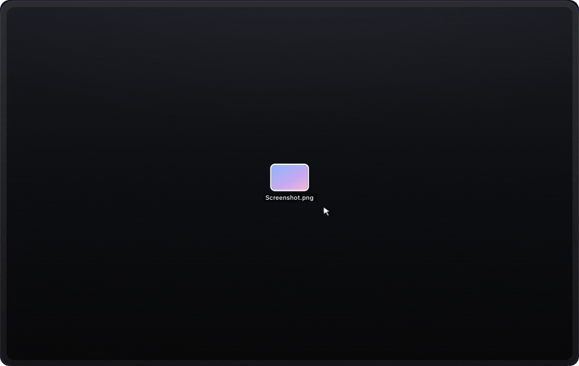

<a href="README.md">English</a>&nbsp;&nbsp;·&nbsp;&nbsp;<b>简体中文</b>

# Optional

### 把 Option-Tab 用在所有地方

按住左侧 Option，点一个字母，松开。剪贴板、窗口、最近文件、耳机，还有针对你选中内容的操作。一个手势，不用打字。

免费&nbsp;&nbsp;·&nbsp;&nbsp;macOS 14 及以上&nbsp;&nbsp;·&nbsp;&nbsp;Apple 芯片

 

<picture>
  <source media="(prefers-color-scheme: dark)" srcset="assets/wheels-dark.gif">
  
</picture>

 

## 按住·点一下·松开

| 按住 | 点一下 | 松开 |
| :--- | :--- | :--- |
| <kbd>⌥</kbd>，或你选的任意键。 | 字母打开轮盘，再点就移动。 | 立即执行。<kbd>Esc</kbd> 退出。 |

<picture>
  <source media="(prefers-color-scheme: dark)" srcset="assets/demo-dark.gif">
  
</picture>

⌥V 从剪贴板粘贴&nbsp;&nbsp;·&nbsp;&nbsp;⌥Tab 切换窗口&nbsp;&nbsp;·&nbsp;&nbsp;⌥S 打开深色模式

## 多个轮盘，精心设计。

不用设置。每一个都装着你此刻正在用的东西。按住 <kbd>⌥</kbd> 再点：

| 按键 | 轮盘 | 内容 |
| :---: | :--- | :--- |
| <kbd>L</kbd> | **最新** | 刚截的图、刚下载的文件、刚复制的内容，每一项都写明来源和时间。 |
| <kbd>V</kbd> | **剪贴板** | 文字、图片、文件、链接、颜色。松开即粘贴，按住 Shift 粘贴为纯文本。 |
| <kbd>Tab</kbd> | **窗口** | 所有窗口，包括最小化的和其他桌面上的。直接打字过滤，输入 we 就能找到微信。 |
| <kbd>F</kbd> | **最近文件** | 截图、下载、刚保存的文件。松开直接贴进聊天框或网页上传框。 |
| <kbd>A</kbd> | **音频** | 切换扬声器、耳机和麦克风。 |
| <kbd>B</kbd> | **蓝牙** | 连接或断开已配对的设备。 |
| <kbd>T</kbd> | **浏览器标签页** | Safari、Chrome、Arc、Edge、Brave 里的所有标签页。 |
| <kbd>I</kbd> | **输入法** | 在英文、拼音、日文等输入法之间切换。 |
| <kbd>C</kbd> | **日历会议** | 接下来的会议，松开直接入会。 |
| <kbd>S</kbd> | **系统开关** | 深色模式、Wi-Fi、夜览、防休眠等，还能放进任意快捷指令。 |
| <kbd>O</kbd> | **常用应用** | 最多八个应用，位置固定，用久了不看屏幕也能划到。 |
| <kbd>M</kbd> | **应用命令** | 前台应用里你最常用的命令，位置固定。打字可以找到任何菜单项。 |
| <kbd>Space</kbd> | **情境** | 针对你选中内容的操作。 |

每个轮盘都可以是类似 Command-Tab 的横排、圆形轮盘或列表。按键、大小和颜色都随你改。

## 边缘拖拽。

一开始拖动文件，屏幕边缘就成了可以放下的地方：隔空投送、邮件、信息、暂存架、压缩、转换为 JPEG、压缩为 Zip、复制路径，或者你添加的任意应用。

<picture>
  <source media="(prefers-color-scheme: dark)" srcset="assets/edge-drops-dark.gif">
  
</picture>

## 智能剪贴板。

根据你要粘贴的地方智能地排好顺序。

| 粘贴到 | 优先显示 |
| :--- | :--- |
| 浏览器地址栏 | 链接 |
| 微信、Slack、信息 | 图片和文件 |
| 终端 | 命令和路径 |
| 代码编辑器 | 代码 |
| Figma 等设计应用 | 颜色和图片 |

点 <kbd>Space</kbd> 可以叠放多项：松开时粘贴第一项，之后每按一次 <kbd>⌘</kbd><kbd>V</kbd> 粘贴下一项。密码，以及其他应用标记为敏感的内容，永远不会被记录。

## 选中，⌥ 空格。Done

针对你选中内容的操作，结果直接替换在原处。

| 选中 | 选择 | 变成 |
| :--- | :--- | :--- |
| `128 × 3` | = 384 | `384` |
| `weekend in kyoto` | 大小写转换 | `WEEKEND IN KYOTO` |
| `ryokan.example/?utm_source=ad` | 去掉追踪参数 | `ryokan.example/` |

还有复制为 Markdown 链接、用其他浏览器打开、中英文之间加空格、转为全角、网页搜索、发送到隔空投送、信息或邮件，以及针对访达里文件、图片和 PDF 的操作。

## ⌥Z，全局撤回。

刚切换的窗口、刚粘贴的内容、刚换的耳机，都能撤回。

## 始终本地。

你复制的内容只留在你的 Mac 上。没有账户、没有数据统计、没有广告。Optional 只在检查更新时联网；当你复制 Markdown 链接时，它会访问那个网页读取标题。[隐私政策](https://optional.pro/zh/privacy)

## 安装

1. [下载 Optional](https://optional.pro/zh/download)，打开 .dmg，把 Optional 拖进“应用程序”。
2. 打开 Optional，它会出现在菜单栏里。
3. 按提示允许辅助功能权限，然后试试按住左侧 Option。

Optional 会自动更新。官方版本只从 [optional.pro](https://optional.pro/zh/) 发布，使用 Developer ID 签名并经 Apple 公证。[更新日志](https://optional.pro/zh/changelog)

## 反馈

发现问题，或者有想法？就在这里说。

<a href="https://github.com/boyuchengz/optional/issues/new?template=bug_report.yml"><picture><source media="(prefers-color-scheme: dark)" srcset="assets/buttons/bug-zh-dark.png"></picture></a>&nbsp;&nbsp;<a href="https://github.com/boyuchengz/optional/issues/new?template=feature_request.yml"><picture><source media="(prefers-color-scheme: dark)" srcset="assets/buttons/idea-zh-dark.png"></picture></a>

提交前可以先看看[已有的问题](https://github.com/boyuchengz/optional/issues)：给已有的问题点个赞也算数。中文、英文都可以写。更想发邮件？[hi@boyucheng.me](mailto:hi@boyucheng.me)

## 常见问题

<b>支持哪些 Mac？</b>

 
搭载 Apple 芯片、macOS 14 Sonoma 及以上的 Mac。2020 年 M1 以来的所有 Apple 芯片 Mac 都可以。
  

<b>为什么需要辅助功能权限？</b>

 
任何要感知按住的按键、替你粘贴或切换窗口的应用，macOS 都要求这项权限。Optional 不会记录你输入的内容。屏幕录制、日历、自动化都是可选的，只在用到对应轮盘时才询问。
  

<b>它和 Raycast、Spotlight 有什么不同？</b>

 
那些都从搜索框开始：打开、打字、选择。Optional 从你按住的那个键开始，而且从不抢走当前应用的焦点，所以它能直接粘贴到你正在用的地方、针对选中内容操作、把每个应用的命令放在固定位置，还能撤销刚做的事。两者可以一起用，实际上重叠不多。
  

<b>我平时也用左侧 Option 怎么办？</b>

 
在设置里换一个触发键：右侧 Option、右侧 Command、右侧 Control、左侧 Control 或 Fn 都行。没有分配给轮盘的字母照常传给当前应用，Option 加其他修饰键（⌥⌘…）也会交给当前应用。
  

<b>有 Mac App Store 版吗？</b>

 
没有。Optional 从 optional.pro 下载，使用 Developer ID 签名并经 Apple 公证，会自动更新。
  

 

由 <a href="https://boyucheng.me">张博禹成</a> 制作

